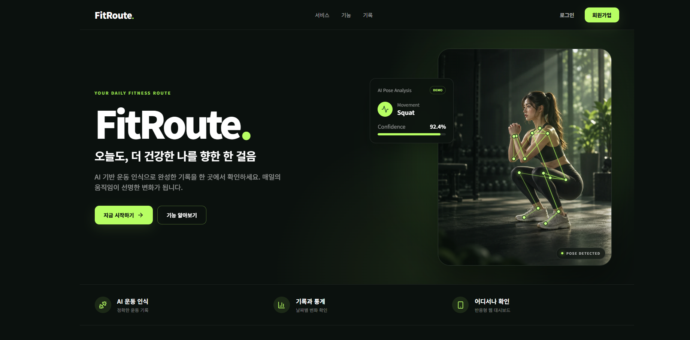
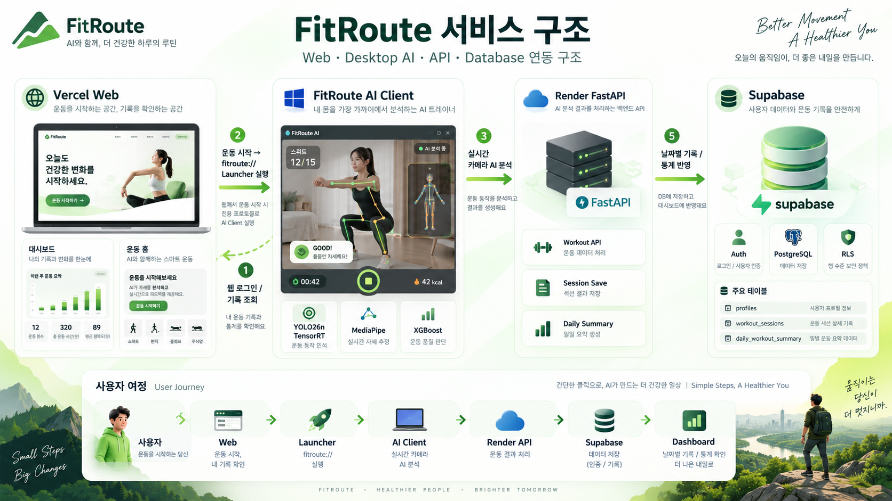
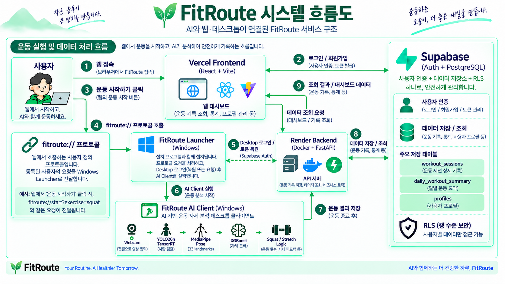
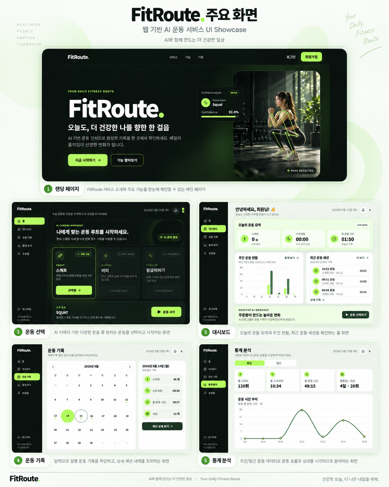
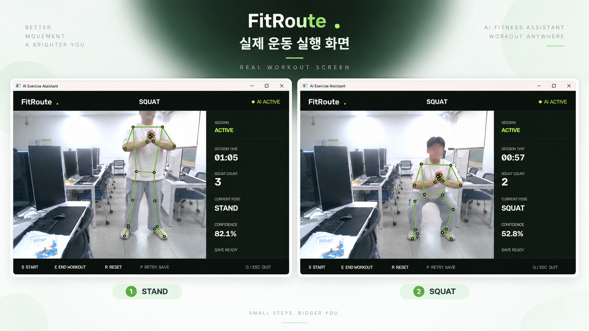
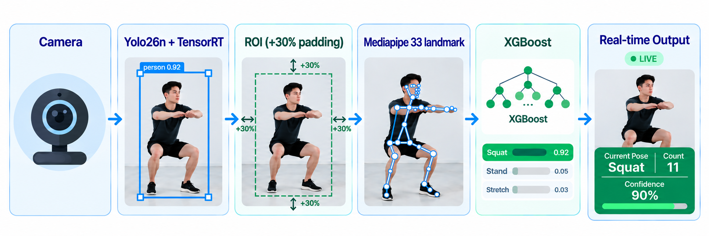
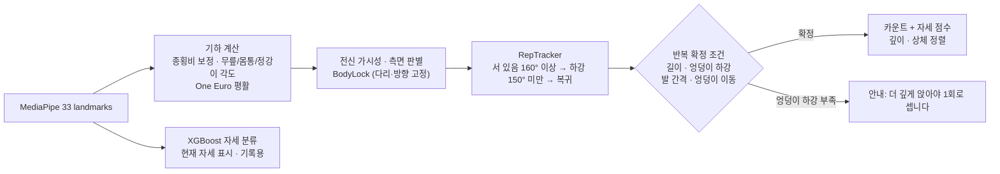

<div align="center">

# FitRoute

### AI 기반 실시간 운동 자세 분석 · 운동 기록 관리 웹 서비스

AI Client가 실시간 자세를 분석하고, 운동 결과를 DB에 저장해 대시보드·운동 기록·통계 기능을 제공하는 서비스입니다.

**개인 프로젝트 · Full-stack / AI / Desktop / Deployment**

**[포트폴리오 PPT](docs/FitRoute-AI-Exercise-Assistant.pdf)**

[Demo](https://fitroute-ivory.vercel.app) · `React + Vite` · `FastAPI` · `Supabase` · `YOLO26n` · `TensorRT` · `MediaPipe` · `XGBoost`

<br />



</div>

---

## 1. 프로젝트 개요

FitRoute는 **AI 운동 클라이언트와 웹 서비스를 하나의 사용자 흐름으로 연결한 운동 기록 서비스**입니다.

AI Client는 Webcam 영상을 실시간 분석해 자세를 분류하고 스쿼트 반복 횟수와 스트레칭 시간을 기록합니다. v0.2.0부터는 스쿼트 횟수를 무릎 각도 시계열로 세고, 반복마다 깊이와 상체 정렬을 평가한 자세 점수를 보여줍니다. 운동 종료 후 결과는 Render FastAPI를 거쳐 Supabase PostgreSQL에 저장되며, 사용자는 웹에서 일별 기록과 통계를 다시 확인할 수 있습니다.

| 항목     | 내용                                                                                                              |
| -------- | ----------------------------------------------------------------------------------------------------------------- |
| **문제** | 자세 인식 모델만으로는 사용자가 직접 설치·실행하고 운동 결과를 저장·조회하는 완결된 서비스 경험을 제공하기 어려움 |
| **목표** | 실시간 자세 분석 → 운동 기록 → 서버 저장 → 대시보드 조회까지 하나의 End-to-End 서비스 흐름으로 연결               |
| **기간** | v0.1: 2026.09.04 ~ 2026.09.16 (약 2주) · v0.2.0: 2026.10.12 ~ 2026.10.21 (스쿼트 판정 고도화)                     |
| **역할** | 개인 프로젝트 — 기획 · AI · Web/API · Desktop · 배포 전 과정 구현                                                 |

### Tech Stack

| 영역                       | 기술                                                           |
| -------------------------- | -------------------------------------------------------------- |
| **Languages**              | Python, JavaScript / TypeScript                                |
| **Frontend**               | React, Vite                                                    |
| **Backend / API**          | FastAPI                                                        |
| **AI / Computer Vision**   | OpenCV, Ultralytics YOLO26n, MediaPipe PoseLandmarker, XGBoost |
| **Inference Acceleration** | TensorRT                                                       |
| **Database / Auth**        | Supabase Auth, PostgreSQL, RLS                                 |
| **Desktop Integration**    | Windows Custom URI Scheme, Windows Credential Manager          |
| **Containerization**       | Docker                                                         |
| **Packaging**              | PyInstaller, Inno Setup                                        |
| **Cloud / Deployment**     | Vercel, Render, Cloudflare R2                                  |

### 실행 환경 및 지원 범위

| 영역              | 현재 지원 범위                                                  |
| ----------------- | --------------------------------------------------------------- |
| Web               | Desktop / Mobile 브라우저에서 로그인, 대시보드, 기록, 통계 조회 |
| AI Workout        | Windows Desktop Client                                          |
| 스쿼트 판정       | 카메라에 옆모습이 보이는 측면 시점 전용 (v0.2.0)                |
| GPU Inference     | NVIDIA GPU + 호환 Driver 기반 TensorRT runtime                  |
| Mobile AI Runtime | 현재 미지원 — 별도 native/mobile inference backend 필요         |

Windows Installer에는 Python runtime과 주요 dependency 및 모델이 포함되어 있어 사용자 PC의 기존 Python 환경을 변경하지 않습니다.

---

## 2. 서비스 구조

FitRoute는 **Web / Windows Client / API / Database**를 분리하고, 각 역할을 독립적으로 구성했습니다.

<p align="center">
  
</p>

| Component          | Role                                         |
| ------------------ | -------------------------------------------- |
| Vercel Frontend    | React + Vite 기반 웹 UI                      |
| FitRoute Launcher  | 웹 요청 처리, 인증 상태 확인, AI Client 실행 |
| FitRoute AI Client | 실시간 Webcam inference 및 운동 로직         |
| Render Backend     | FastAPI 기반 운동 저장/조회 API              |
| Supabase           | Auth + PostgreSQL + RLS                      |
| Cloudflare R2      | Windows Installer 배포                       |

운동 세션과 일별 요약 데이터는 Supabase PostgreSQL에 저장하며, 사용자별 데이터 접근은 RLS 기반으로 분리합니다.

---

## 3. 시스템 흐름도

<p align="center">
  
</p>

### 인증 및 운동 실행

```text
사용자
  ↓
Vercel Frontend
  ↔ Supabase Auth
  ↓ 운동 시작
fitroute://
  ↓
FitRoute Launcher
  ↔ Supabase Auth (Desktop 로그인 / 토큰 복원)
  ↓
FitRoute AI Client
```

### 운동 결과 저장 및 조회

```text
AI Client
  ↓ POST /api/workouts
Render Backend
  ↔ Supabase PostgreSQL

Frontend
  ↓ 조회 요청
Render Backend
  ↔ Supabase
  ↓
Frontend
```

Frontend가 운동 기록을 Supabase에서 직접 조회하지 않고, **Backend API를 통해 조회 및 응답받도록 역할을 분리**했습니다.

### Desktop 연동 및 인증

- Launcher는 허용된 명령어와 운동 종류만 실행되도록 제한
- 하위 프로그램 실행 시 `shell=False`를 사용해 불필요한 명령 해석을 방지
- 사용자 비밀번호는 저장하지 않음
- refresh token은 Windows 자격 증명 관리자에 저장
- access token은 URL / argv / config / log에 기록하지 않고 실행 중인 AI Client에만 전달
- 동시에 여러 카메라가 실행되지 않도록 중복 실행 방지 처리

---

## 4. 실제 구현 화면

### Web Service

<p align="center">
  
</p>

### Real-time AI Workout

Pose를 추정하고, 현재 자세와 Confidence를 표시하며 스쿼트 반복 횟수를 기록합니다.

<p align="center">
  
</p>

---

## 5. 핵심 기능

### 실시간 AI 운동 분석

<p align="center">
  
</p>

> 위 그림은 사람 검출부터 자세 분류(XGBoost)까지의 파이프라인입니다. **v0.2.0부터 스쿼트 횟수는 XGBoost 라벨이 아니라 아래의 무릎각 기반 반복 추적으로 셉니다.** XGBoost 라벨은 화면의 현재 자세 표시와 기록용으로만 쓰입니다.

[[상세_파이프라인]](docs/AI_client_Pipeline.md)

### 스쿼트 반복 추적과 자세 점수 (v0.2.0)



**반복 분할**

- 엉덩이-무릎-발목 무릎각을 프레임마다 계산합니다. MediaPipe 좌표는 crop 기준 0~1 정규화 값이라, 매 프레임 crop의 가로세로 비율로 보정한 뒤 각도를 구합니다.
- 각도는 타임스탬프 기반 One Euro 필터로 평활하고, 무릎각 160° 이상(서 있음)과 150° 미만(하강) 사이에 히스테리시스를 둔 상태 머신으로 반복 1회를 자릅니다.

**측면 전용 판정과 BodyLock**

- 서 있는 동안 측면 시점이 0.5초 이어지면 카메라에 가까운 다리와 서 있는 방향을 잠그고, 반복 중에는 고정합니다. 서 있을 때 측면이 아닌 상태가 0.4초 이어지면 잠금을 풉니다.
- 엉덩이·무릎·발목·뒤꿈치·발끝·어깨가 화면 안에 보일 때만 각도를 유효로 처리합니다.

**반복 확정 조건 (기하 조건만 사용)**

| 조건 | 기준 | 막는 동작 |
| --- | --- | --- |
| 반복 길이 | 1.0초 이상 | 걷기·자세 정리 중 짧은 굽힘 |
| 엉덩이 하강 | 다리 길이(L)의 0.20 이상 | 제자리 걷기 |
| 서 있을 때 발 간격 | 0.25 L 이하 | 한 걸음 내딛은 런지 |
| 최저점 발 간격 | 0.40 L 이하 | 발을 모으고 시작해 내딛는 런지 |
| 반복 중 엉덩이 수평 이동 | 0.70 L 이하 | 세트 후 자리를 뜨는 동작 |

XGBoost 라벨 비율은 확정 조건에서 제외하고 기록만 합니다(아래 문제 해결 6·7 참고).

**자세 점수**

| 항목 | 정상 | 교정 | 비고 |
| --- | --- | --- | --- |
| 깊이 (최저 무릎각) | 80° 이하 | 95° 이상 | 80° 100점 · 95° 50점 · 120° 0점(임시값) |
| 상체 정렬 (최저점 몸통각 − 정강이각) | 25° 이하 | 35° 이상 | 깊이가 교정이면 판정하지 않고 기록만 |

- 두 항목 점수의 가중 평균으로 "자세 점수"를 계산하고, 반복이 끝날 때 `78점 · 더 깊게 앉아보세요`처럼 가장 많이 감점된 항목의 피드백과 함께 보여줍니다.
- 점수 옆에 "깊이·상체"를 표기하고, 세션 시작 시 "자세 점수는 깊이와 상체 정렬만 봅니다"를 안내합니다. 뒤꿈치·템포·무릎 위치는 평가하지 않습니다.

**화면 안내**

- 구도: 발 아래 여유가 없거나 몸이 화면을 거의 채우면 "뒤로 물러서 주세요", 판정용 crop이 좌우로 잘리면 "화면 가운데로 이동해 주세요"
- 잠금: 측면이 아니면 "카메라 쪽으로 옆모습이 보이게 서주세요", 전신이 보이지 않으면 "발끝까지 화면에 들어오게 서주세요"

### 운동 세션 기록

- 운동 세션 시작/종료
- 총 운동 시간, 스쿼트 횟수, 스트레칭 누적 시간 저장
- 운동 종료 후 Backend API를 통해 저장
- 저장 실패 시 P 키로 수동 재시도 가능 (앱을 닫으면 대기 중인 요약은 사라짐, `Known Issues` 참고)
- v0.2.0: 세션 결과와 반복별 판정(항목 status, 점수, 탈락 사유)을 로컬 기록 파일(`%LOCALAPPDATA%\FitRoute\workout_logs\`)로도 저장

### 웹 기록 및 통계

- 오늘의 운동 요약
- 최근 운동 세션 조회
- 날짜별 운동 기록
- 주간/월간 운동 통계
- 프로필 관리

[[실시간 처리 성능]](docs/Runtime_Performance.md)

---

## 6. Build & Release Engineering

AI Client를 실제 사용자 환경에 전달하기 위해 **패키징·최적화·Installer 제작부터 버전별 배포·검증·DEMO 반영까지** 하나의 release workflow로 구성했습니다.

### Packaging & Optimization

AI Client는 PyInstaller `onedir` 방식으로 패키징했으며, 실제 inference runtime을 유지하면서 불필요한 의존성을 제거해 bundle 크기를 최적화했습니다.

| 단계                  |        결과 |
| --------------------- | ----------: |
| 초기 AI Client bundle | 약 6.79 GiB |
| 최종 AI Client bundle | 약 4.85 GiB |
| Bundle 감소           |    약 28.7% |
| 최종 Installer        |   2.216 GiB |

주요 최적화:

- TensorRT builder 전용 resource 제거
- Polars runtime 제거
- `torch/bin/protoc.exe` 제거
- CUDA / Torch / TensorRT runtime module trace를 통해 추가 제거 가능성 검증

최종 Installer는 Launcher, Frozen AI Client, 모델과 production config를 포함하며 Cloudflare R2를 통해 배포합니다.

---

### [Release Workflow](docs/Release_Workflow.md)

### Version History

| Version  | 내용                                                                                                                          |
| -------- | ----------------------------------------------------------------------------------------------------------------------------- |
| `v0.1.0` | Windows Launcher + AI Client 초기 Production 배포                                                                             |
| `v0.1.1` | Prepare / Promote / Rollback 기반 Windows Release workflow 정식화, R2 versioned distribution 및 Vercel Production 배포 안정화 |
| `v0.2.0` | 스쿼트 반복 추적 기반 카운트(측면 전용), 자세 점수, 구도 안내, 로컬 운동 기록                                                 |

### v0.1.1 Release

- Release date: **2026-09-15**
- Installer: `FitRoute-AI-Client-Setup-0.1.1.exe`
- Size: **2,379,641,099 bytes (2.216213 GiB)**
- SHA-256:

```text
748E721160116539DA8ABADCA329C43BFAAE8A52E06AFB3FEB458554D6E2D0DD
```

### v0.2.0 Release

- Release date: **2026-10-21**
- Installer: `FitRoute-AI-Client-Setup-0.2.0.exe`
- Size: **2,379,765,928 bytes (2.216330 GiB)**
- Download: `https://pub-08036d191fd84004a7a3d27bf8521aaf.r2.dev/releases/v0.2.0/FitRoute-AI-Client-Setup-0.2.0.exe`
- SHA-256:

```text
5D243B3BF6B07CAF49309CCB7E19606FE450FF9B160AED97E314130F59904EA9
```

- R2 업로드본 설치 테스트(2026-10-21): 받은 파일의 SHA-256 일치, 설치·런처 실행·스쿼트 카운트·로컬 기록 정상. 첫 세션 서버 업로드는 실패했고(`Known Issues` 참고) 같은 설치 상태의 두 번째 세션은 업로드에 성공했습니다.
- 상세 기록: [v0.2.0 RELEASE](docs/versions/v0.2.0/RELEASE.md) · [DEVLOG](docs/versions/v0.2.0/DEVLOG.md)

---

## 7. 검증 결과

### 기능 및 통합 검증

- `fitroute://`를 통한 Web → Launcher → AI Client 실행 확인
- Webcam 입력부터 TensorRT → MediaPipe → XGBoost까지 AI runtime 동작 확인
- 운동 종료 후 Render Backend → Supabase 저장 및 Web Dashboard 조회 흐름 확인
- 별도 Windows PC에서 Installer 다운로드 → 설치 → 실행 → 운동 기록 확인까지 E2E 테스트 수행
  - 최초 실행의 첫 세션 저장 이슈는 `Known Issues`에 별도 기록

### 스쿼트 판정 실측 검증 (v0.2.0)

| 실측 | 참여자 | 역할 | 주요 결과 |
| --- | --- | --- | --- |
| 1차 (2026-10-18) | 본인 | 임계값 결정 | 13개 세션 로그로 무릎각·상체·발 간격 기준값 결정, v0.1.x 카운트 한계 실측 |
| 2차 (2026-10-19) | P01 | 검증 → 불합격 항목으로 조건 수정 | 분류기 라벨 때문에 정상 반복 탈락 발견, ML 조건을 기하 조건으로 대체 |
| 3차 (2026-10-20) | P02 | 값 결정에 쓰지 않은 데이터로 검증 | 측면 카운트 4개 세션 모두 5/5, 런지 두 형태와 걷기 오카운트 0 |
| 연속 세트 확인 (2026-10-20) | 본인 | 반복 사이 정지 0.5초 미만 조건 확인 | 10/10 (반복 사이 서 있는 시간 중앙값 0.30초) |

- 합격 기준은 각 실측 전에 문서로 고정했고, 결과를 본 뒤 규칙에서 벗어난 결정은 그 사실과 이유를 함께 기록했습니다.
- 로그 재생 도구가 실제 파이프라인과 같은 판정을 내는지 원본 로그 26개에서 반복 단위로 대조했습니다.

### 자동화 테스트

- Python test suite (v0.1.1 릴리스 시점) **122 tests passed**
- v0.2.0 준비 시점(2026-10-20) 재측정: AI Client `tests/` **552 passed**, Backend `backend/tests` **37 passed**
- 실측 로그에서 판정에 필요한 값만 추출한 회귀 fixture로 세션별 반복 횟수를 고정 (얼굴 좌표 미포함)

### 배포 검증

- Windows Installer build 및 설치 확인
- Vercel Production 배포 후 HTTP **200** 응답 확인

---

## 8. Known Issues

### 서버가 쉬고 난 뒤 첫 운동 저장 실패 가능성

별도 Windows PC E2E 테스트(v0.1.1)에서 **설치 후 최초 실행의 첫 번째 운동 세션 저장이 정상 처리되지 않는 현상**이 관찰되었고, v0.2.0 설치 테스트(2026-10-21)에서 같은 현상이 다시 재현되었습니다.

- Installer / Launcher / AI Client 실행 정상
- Desktop 인증 및 Camera / AI inference 정상 (런처 로그에서 토큰 전달 확인)
- 같은 설치 상태의 두 번째 세션은 저장 정상, 이후 Render → Supabase 저장 및 Dashboard 조회 정상

**가장 가능성이 높은 원인(확정은 아님)**: 조건은 "설치 직후"가 아니라 **"서버가 한동안 요청을 받지 않은 뒤의 첫 업로드"** 입니다. 유휴 상태의 Render 서버가 깨어나는 데 약 23초가 걸리는데 업로드 시간 제한은 10초라서 첫 요청이 시간 초과로 실패한 것으로 봅니다. 실패하면 요약은 메모리에만 남아 **앱을 닫으면 사라집니다.** 실패 당시 앱 메시지를 확인하지 못해 확정하지는 못했습니다. v0.1.1과 같은 코드 경로라 v0.2.0에서 생긴 회귀가 아닙니다.

- **v0.2.0**: 세션 결과는 내 PC의 로컬 기록(`%LOCALAPPDATA%\FitRoute\workout_logs\`)에 남습니다. 서버에는 올라가지 않았을 수 있습니다.
- **사용자 안내**: 처음 접속할 때 서버가 깨어나는 데 시간이 걸릴 수 있습니다. 첫 세션 기록이 웹에 보이지 않으면 서버가 깨어난 뒤의 세션부터 정상 저장됩니다.
- **이번 릴리스에서는 고치지 않는 한계**로 두었습니다. 예상 해결 방안(업로드를 화면 밖으로 이동하고 시간 제한 상향, 런처의 사전 호출, 종료 시 재시도·알림, 업로드 결과 로그, 로컬 기록 재전송, 서버를 주기 호출로 깨워 두는 운영 방식)과 각 위험은 `docs/versions/v0.2.0/first_upload_limit_and_design.md`에 설계 수준으로 정리했습니다.

### Supabase 무료 프로젝트 일시정지 가능성

Supabase 무료 프로젝트는 일정 기간 활동이 없으면 일시정지될 수 있습니다(기간은 Supabase 정책에 따르며 이 문서에서 확정하지 않습니다). 일시정지되면 **로그인, 기록 저장, 조회가 모두 동작하지 않습니다.** 시연 전에 Supabase 프로젝트가 활성 상태인지 확인해야 합니다.

### 스쿼트 판정 한계 (v0.2.0)

- 측면 시점 전용입니다. 정면·사선에서는 카운트하지 않고 옆모습 안내만 표시합니다.
- 의자·박스에 앉았다 일어나는 동작은 스쿼트와 동작이 같아 카운트될 수 있습니다.
- 뒤꿈치 들림은 판정하지 않습니다(실측에서 정상 자세와 구분되지 않음).
- 임계값은 두 사람(본인, P01) 데이터로 정한 초기값입니다. 카운트는 값 결정에 쓰지 않은 참여자(P02)에서도 확인했지만, 자세 판정(깊이·상체 정렬)은 새 참여자에게서 검증되지 않았습니다.
- 상체 정렬 판정은 정상 자세에서 상체가 많이 서 있는 사람의 중간 정도 숙임을 놓칠 수 있습니다.
- 위에서 멈추지 않는 연속 세트는 본인과 P01에서만 확인했습니다.

전체 목록은 [v0.2.0 RELEASE](docs/versions/v0.2.0/RELEASE.md)에 있습니다.

---

## 9. 문제 해결 경험

### 1) Windows AI bundle 과대화

**문제**  
PyInstaller 결과물이 약 6.79 GiB까지 증가했습니다.

**접근 및 해결**  
Torch / CUDA / TensorRT / Polars 등의 파일을 크기와 runtime load 여부 기준으로 분석하고, 실제 Camera inference가 유지되는 범위에서 약 4.85 GiB까지 축소했습니다.

### 2) 브라우저와 Desktop AI 연결

**문제**  
웹에서 Windows AI 프로그램을 자연스럽게 실행해야 했습니다.

**해결**  
Custom URI Scheme `fitroute://` + Launcher를 설계하고 인증과 AI Client 실행 책임을 Launcher에 분리했습니다.

### 3) 대용량 Installer 배포

**문제**  
2 GiB가 넘는 Installer를 일반적인 Git repository나 Frontend asset으로 관리하기 어려웠습니다.

**해결**  
Cloudflare R2를 binary distribution storage로 분리하고 Vercel은 public download URL만 참조하도록 구성했습니다.

### 4) Vercel 배포 범위 과대화

**문제**  
Production CLI deploy 과정에서 AI runtime과 Installer까지 포함해 수 GB를 업로드하려는 문제가 발생했습니다.

**해결**  
Vercel native process의 Working Directory를 `frontend`로 고정하고 root `.vercelignore`를 allowlist 방식으로 구성해 Frontend만 배포되도록 수정했습니다.

### 5) Vercel CLI stderr 처리

Vercel CLI의 정상 stderr 배너가 PowerShell에서 오류로 처리되는 문제를 확인하고, `System.Diagnostics.Process` 기반 helper에서 StdOut / StdErr / ExitCode를 분리해 **ExitCode == 0**을 성공 기준으로 사용하도록 개선했습니다.

### 6) 분류기 라벨에 의존한 스쿼트 카운트 (v0.2.0, 1차 실측)

**문제**  
v0.1.x는 XGBoost 라벨이 stand → squat → stand로 바뀌는 것으로 1회를 셌습니다. 분류기는 정지 이미지 데이터셋(POLAR)으로 학습했는데, 이 데이터의 squat 클래스는 운동 스쿼트보다 깊게 쪼그려 앉은 자세에 치우쳐 있었습니다. 본인 1차 실측 로그를 v0.1.x 카운터에 다시 넣어 확인한 결과는 다음과 같았습니다(화면 기록과 재계산이 7개 세션 모두 일치).

| 세션 | 실제 | v0.1.x 카운트 |
| --- | --- | --- |
| 하프 스쿼트 | 8 | 5 |
| 정면 | 5 | 2 |
| 측면 반대 방향 | 5~6 | 0 |
| 의자 앉았다 일어나기 (스쿼트 아님) | 0 | 2 |
| 런지 스트레칭 (스쿼트 아님) | 0 | 1 |

중간에 다른 동작이 끼어도 stand → squat → 다른 동작 → stand를 1회로 세는 구조적 문제도 코드에서 확인했습니다.

**해결**  
반복 분할을 무릎각 상태 머신으로 옮기고, 종횡비 보정·측면 판정·BodyLock·전신 가시성 검사를 추가했습니다. 분류기는 "어떤 자세인지" 표시하는 역할로 남겼습니다.

### 7) 사람마다 다른 분류기 라벨 → ML 조건 제거 (v0.2.0, 2·3차 실측)

**문제**  
초기 설계는 반복 구간에서 걷기·달리기·누움 라벨 비율이 0.40을 넘으면 그 반복을 버리는 ML 조건을 두었습니다. 2차 실측(P01)에서 이 참여자의 정상 스쿼트가 run 라벨로 읽혀 측면 세션 두 곳이 5회 중 1회만 세어졌고, 연속 세트도 10회 중 8회였습니다. 런지 1회는 오카운트됐습니다.

**접근**  
ML 조건을 빼고 로그를 재생하니 정상 반복은 모두 살아났지만, ML 조건이 막고 있던 동작 2건(P01 런지, 세트 후 자리를 뜨는 동작)이 새로 세어졌습니다. 이 두 동작을 사람과 무관하게 가를 수 있는 특징을 로그에서 찾았습니다.

**해결**  
ML 조건을 확정 조건에서 제거하고 기하 조건 두 개로 대체했습니다.

- 최저점 발 간격 ≤ 0.40 L: 스쿼트 최대 0.16, 런지 최소 0.84
- 반복 중 엉덩이 수평 이동 ≤ 0.70 L: 스쿼트 최대 0.46, 자리를 뜨는 동작 2.6

**결과**  
값 결정에 쓰지 않은 3차 참여자(P02)에서 측면 카운트 4개 세션이 모두 5/5였고, 걷기와 런지 두 형태의 오카운트는 0이었습니다. P02의 확정 반복 36개 중 19개는 라벨 비율이 0.40을 넘었기 때문에, 기존 ML 조건이었다면 같은 세션들이 4·3·3·2회로 세어졌을 것입니다. 발을 모으고 시작하는 런지 후보 3개는 새로 추가한 최저점 발 간격 조건이 막았습니다.

### 8) 연속 세트 반복 누락 → 구조적 결함 2건 수정 (v0.2.0)

**문제**  
실시간 확인에서 연속 스쿼트 7회 중 4·5번째가 세어지지 않았습니다. 당시에는 로깅을 끈 상태라 원인을 바로 알 수 없었습니다.

**접근**  
반복 후보·탈락 사유·잠금 해제를 이벤트로 남기는 진단 로깅을 추가하고, 기존 로그를 프레임 솎아내기(12~5 FPS)와 합성 시퀀스로 재생했습니다.

**해결**  
두 가지 결함을 찾아 기본 동작으로 고쳤습니다.

- 서 있는 동안 사람 검출이 2프레임(0.12초)만 끊겨도 "서 있음" 상태가 초기화되어, 다시 보인 순간 이미 내려가고 있으면 그 반복이 시작되지 않았습니다. 1.5초 이하의 짧은 끊김은 상태를 유지하도록 바꿨습니다.
- 서 있을 때 두 다리가 겹치면 카메라에서 먼 다리로 잠금이 굳어 빠져나오지 못하는 교착(최대 4.9초)이 있었습니다. 반대 다리가 0.5초 이상 유효하면 잠금을 넘기도록 바꿨습니다.

**결과**  
기존 로그 전체의 반복 횟수는 그대로였고, 5 FPS 재생에서 누락되던 3회가 회복됐습니다. 반복 사이 정지 0.3초 수준의 연속 세트는 본인과 P01 모두 10/10이었습니다. 실시간 확인의 4·5번째 누락이 이 결함 때문이었는지는 당시 로그가 없어 확정하지 못했습니다.

### 9) 랜드마크 공백의 원인은 모델이 아니라 구도 (v0.2.0)

**문제**  
사람은 99.8% 검출되는데, MediaPipe 랜드마크가 없는 프레임이 12~21%였습니다.

**접근**  
로그 16개(18,417프레임)에서 공백이 어디에 몰리는지 자세·각도·bbox 위치별로 분석했습니다.

**결과 및 해결**  
세트 안 공백 239개 중 237개가 bbox가 화면 경계에 닿은 프레임이었고, crop이 화면에 잘리지 않으면 공백률은 0.1%였습니다. 모델 설정이 아니라 사용자가 카메라에 너무 가깝게 선 것이 원인이었습니다. 랜드마크가 없으면 기존 안내도 뜨지 않는 빈틈이 있어, YOLO bbox만으로 판단하는 구도 안내("뒤로 물러서 주세요", "화면 가운데로 이동해 주세요")를 추가했습니다.

### 10) 적은 실험자로 과적합을 피하는 검증 설계 (v0.2.0)

**문제**  
참여자가 세 명뿐이라, 값을 정한 데이터로 다시 검증하면 결과가 낙관적으로 나올 수밖에 없었습니다.

**해결**

- 각 실측을 "값을 정하는 실측"과 "검증하는 실측"으로 나누고, 합격 기준을 실측 전에 문서로 고정했습니다.
- 2차 실측 데이터로 조건을 고친 뒤에는 그 데이터를 검증용으로 쓰지 않았고, 3차는 새 참여자로 진행했습니다.
- 3차에서 깊이·상체 판정이 불합격했을 때, 참여자가 지시 동작(평행 깊이, 충분한 상체 숙임)을 하지 않은 것으로 보였지만 영상이 없어 확정할 수 없었습니다. 그래서 기준을 바꾸지 않고 "자세 판정은 새 참여자에게서 검증되지 않음"을 한계로 남겼습니다.
- "ML 조건은 아무것도 막지 못했다"는 중간 판단이 재생 결과로 틀린 것을 확인하고 정정했으며, 분석 도구와 실제 구현의 계산이 어긋난 사례를 찾은 뒤 결정 근거로 쓴 모든 재생 도구를 실제 코드와 대조했습니다.

---

## 10. 관련 기술 문서

세부 설계·검증·배포 과정은 별도 문서로 분리했습니다.

- [Repository Structure](docs/Repository_Structure.md)
- [Windows Release Process](docs/windows_release_process.md)
- [Windows Installer](docs/windows_installer.md)
- [Desktop Launcher](docs/desktop_client_launcher.md)
- [AI Client Packaging Plan](docs/ai_client_packaging_plan.md)
- [Bundle Size Analysis](docs/ai_client_bundle_size_analysis.md)
- [Torch Slimming Analysis](docs/ai_client_torch_slimming_analysis.md)
- [Runtime Module Trace](docs/runtime_module_trace.md)
- [Production Deployment Checklist](docs/production_deployment_checklist.md)
- [v0.2.0 RELEASE](docs/versions/v0.2.0/RELEASE.md)
- [v0.2.0 DEVLOG](docs/versions/v0.2.0/DEVLOG.md)
- [첫 업로드 실패 한계와 해결 설계](docs/versions/v0.2.0/first_upload_limit_and_design.md)
- [Backend Guide](backend/README.md)
- [Frontend Guide](frontend/README.md)
- [Docs Index](docs/README.md)

---

## 11. 프로젝트를 통해 얻은 경험

- AI 모델을 단독으로 실행하는 것에서 그치지 않고 **사용자가 실제로 설치·실행·기록 조회까지 할 수 있는 End-to-End AI 서비스**로 연결한 경험
- Computer Vision / Pose / ML을 실제 운동 기능과 상태 기반 로직으로 연결한 경험
- 분류 모델의 한계를 실측으로 확인하고, 사람과 무관한 기하 조건으로 판정 로직을 다시 설계한 경험
- 소수 참여자 실측에서 값 결정과 검증을 분리하고, 합격 기준을 먼저 고정해 결과를 해석한 경험
- Web과 Windows Desktop application을 Custom URI Scheme으로 연동한 경험
- 인증·API·DB를 포함한 사용자별 데이터 흐름을 설계하고 Production 환경에 배포한 경험
- AI runtime을 독립 실행 파일과 Installer로 패키징하고, 대용량 dependency를 분석·최적화한 경험
- 별도 Windows PC E2E 검증과 versioned release / promote / rollback workflow를 구성한 경험
- 오류를 단순 수정하는 데서 끝내지 않고 로그, runtime trace, deployment manifest를 기준으로 원인을 분리해 해결한 경험

---

## 12. 향후 발전 방향

- **서비스 확장**: AI 서비스 외에 실제 트레이너와의 소통이 가능하도록 확장
- **운동 종류 확장**: 현재 Squat / Stretch 중심의 기능을 추가 운동과 반복 동작 로직으로 확장
- **스쿼트 판정 고도화**: 개인별 정상 자세 기준 보정, 정면 시점(무릎 모임) 판정, 더 많은 참여자로 자세 판정 검증
- **첫 업로드 실패 해결**: 업로드를 화면 루프 밖으로 옮기고 로컬 기록 재전송 추가 (설계 문서 참고)
- **실시간 추론 최적화**: AI Pipeline latency와 실제 End-to-End 처리 시간을 기반으로 runtime 성능 개선
- **Desktop Client 경량화**: PyInstaller bundle 및 Torch / CUDA runtime dependency를 추가 분석해 Installer 크기 감소 검토
- **모바일 확장 검토**: 장기적으로 Android / iOS 환경에 맞는 별도 inference architecture 검토

---

<div align="center">

### FitRoute

**작은 운동이 큰 변화를 만듭니다.**  
AI와 함께 만드는 더 건강한 일상

</div>
