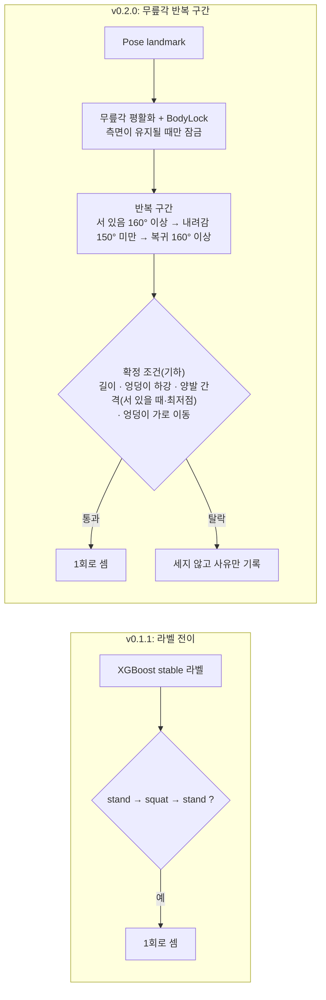

# FitRoute AI Client v0.2.0

## 1. 한 줄 요약

스쿼트 횟수를 AI 동작 라벨이 아니라 **무릎각 시계열**로 세고(측면 전용), 반복마다 **깊이·상체 정렬 점수**와 **구도 안내**를 화면에 보여 주며, 세션 기록(반복별 판정 포함)을 내 PC에 저장합니다. 카운트는 세 사람으로 확인했지만 자세 판정은 값을 정한 두 사람의 데이터로만 확인된 **초기 기준**입니다(5절).

## 2. 무엇이 바뀌었나 (v0.1.1 대비)

- 반복을 **라벨이 아니라 무릎각 시계열**로 나눕니다. AI 동작 라벨(`walk`, `run`, `lying`)의 비율은 반복을 확정하는 조건에서 **뺐고**, 로컬 기록 파일에 값만 남깁니다(앉는 동작이 달리기로 읽혀 정상 반복이 빠지는 사람이 있었습니다).
- 걷기처럼 짧은 굴곡, 런지처럼 양발이 앞뒤로 벌어진 동작은 세지 않습니다.
- **측면에서 서 있을 때만** 반복 추적을 시작합니다(정면·사선에서는 세지 않습니다).
- 설정 `USE_REP_TRACKER`를 False로 하면 v0.1.x 방식(라벨 전이)으로 셉니다.
- **구도 안내(화면)**: 카메라에 너무 가깝거나 가장자리에 걸려 있으면 영상 아래쪽에 "뒤로 물러서 주세요"(발이 화면 아래 경계에 닿거나 발 아래 여유가 화면 높이의 4% 이하, 또는 몸 높이가 화면 높이의 95% 이상) 또는 "화면 가운데로 이동해 주세요"(몸 양옆의 여유가 잘림: 사람 검출 상자 폭의 30% 여유 중 절반 이상이 화면 밖으로 나감)가 나옵니다. 1.5초 이상 이어질 때만 나오고, 반복 중에는 나오지 않으며, 다른 안내(옆모습, 발끝)보다 먼저 나옵니다. 사람 검출(YOLO) 상자만으로 판단하므로 포즈 인식이 실패해도 나옵니다. 로그 16개를 다시 재생해 보니 포즈 인식이 실패한 프레임의 79%가 이 안내가 켜져 있는 동안이었습니다(실제 화면에서의 확인은 별도).
- **자세 점수 표시(화면)**: 반복이 확정되면 영상 아래쪽에 "N점 · 개선할 점"(예: "78점 · 더 깊게 앉아보세요") 한 줄이 3초간 나오고, 점수 오른쪽에 작은 회색 "깊이·상체" 표기가 붙습니다(감점이 없으면 "100점"만). 처음 잠금이 걸려 서 있을 때 세션당 한 번 "자세 점수는 깊이와 상체 정렬만 봅니다"가 5초간 나옵니다. 엉덩이 하강이 부족해서만 세어지지 않은 반복에는 "더 깊게 앉아야 1회로 셉니다"가 나오고, 그 밖의 이유로 세어지지 않은 반복은 화면에 표시하지 않고 기록만 합니다. `USE_REP_TRACKER`를 끄면 점수와 안내는 나오지 않습니다.
- **운동 기록이 내 PC에 저장됩니다**: 세션이 끝나면 `workout_<시작시각>.json` 한 파일이 저장됩니다(개발 실행은 `data/workout_logs/`, 설치판은 `%LOCALAPPDATA%\FitRoute\workout_logs\`). 서버로 보내는 요약과 같은 항목에, 반복마다 항목별 판정·점수·개선할 점·세지 않은 이유가 들어 있습니다. 영상이나 관절 좌표는 저장하지 않으며, 저장에 실패해도 세션 종료와 서버 저장은 그대로 진행됩니다. 서버로 보내는 형식은 바꾸지 않았습니다(형식: `workout_record_format.md`).
- **개선 1: 짧은 사람 놓침이 서 있는 상태를 지우지 않습니다.** 서 있는 중 사람이나 자세를 1.5초 이하로 놓쳐도(잠금이 유지되는 동안) 서 있던 상태와 기준값을 그대로 두므로, 다시 보인 첫 프레임이 이미 내려가는 중이어도 그 반복을 셉니다. 로그 재생으로 확인한 것: 내려가기 직전에 놓침이 있어 5 FPS로 솎아낸 재생에서 빠지던 반복 3건이 모두 세어지고(수정 전 누락 3건 → 0건), 내려가기 직전에 사람 없음 0.12~0.6초를 끼워 넣은 재생에서 연속 세트 2개와 1차 세션 1~5의 반복이 모두 세어집니다(수정 전에는 0.12초만 덮어도 그 반복을 놓쳤습니다).
- **개선 2: 잠근 다리가 가려져도 반대 다리로 이어받습니다.** 서 있을 때 두 다리가 겹쳐 잠근 다리가 가려지면 반복 추적이 시작되지 않고 멈춰 있던 문제를 고쳤고, 다리 선택에 히스테리시스를 넣었습니다. 로그를 처음부터 다시 계산한 재생에서, 서 있는데 반복 추적이 시작되지 않던 시간이 2026-10-19 빠른 연속 세트 로그에서 5.0초 → 0초, 보통 속도 로그에서 1.1초 → 0초가 되었고 잠금 다리가 바뀐 횟수는 늘지 않았습니다. 두 개선 모두 기존 로그 15개의 센 횟수를 바꾸지 않았습니다.

## 3. 왜 바꿨나

v0.1.1은 XGBoost가 분류한 `stand`/`squat` 라벨이 `stand → squat → stand`로 바뀌면 반복 1회로 셉니다. 이 방식에는 두 가지 한계가 있습니다.

**1. 중간에 다른 동작이 끼어도 1회로 셉니다.**
카운터는 `stand`와 `squat`이 아닌 라벨을 무시하기만 하고 반복을 무효로 하지 않습니다. 그래서 `stand → squat → (걷기·뛰기·눕기 등) → stand`도 1회로 기록됩니다. 반복 도중 자리를 떠났다가 돌아와도 같은 방식으로 이어집니다. 코드를 읽어 확인한 구조이며, 실제 사용 중 얼마나 발생하는지는 측정하지 않았습니다.

**2. 하프 스쿼트는 `squat` 라벨에 기대기 어렵습니다.**
라벨 분류기는 POLAR 정지 이미지 데이터(33,994장)로 학습되었습니다. 이 데이터를 분석한 결과는 다음과 같습니다.

- 측면에서 촬영된 `squat` 샘플의 81.8%(956장 중)가 무릎각 90° 미만입니다. 쪼그려 앉는 깊은 자세가 대부분이고, 얕은 자세는 거의 없습니다.
- 무릎각이 90~150°인 측면 샘플(test 483장)에서 모델이 `squat`이라고 답한 비율은 2.1%입니다. 정답이 `squat`인 샘플만 보면(23장, 표본이 적습니다) 17.4%만 `squat`으로 분류되고 나머지는 주로 `bendover`(47.8%)와 `sit`(17.4%)로 분류됩니다.
- 데이터가 정지 이미지라 시간 순서 정보가 없어, 반복 동작 단위로는 검증할 수 없습니다.

그래서 v0.2.0은 반복 구간을 라벨이 아니라 **무릎각 시계열**로 나눕니다. 라벨은 처음에는 반복 구간 안에 다른 운동(걷기·달리기·눕기)이 많이 섞였는지 확인하는 2차 조건으로 쓰려 했지만, 실측에서 정상 반복이 이 조건으로 탈락하는 사람이 있어 확정 조건에서 뺐습니다(라벨 비율은 기록만 합니다). 점프 라벨은 정상 스쿼트의 하강 구간 17%, 상승 구간 22%에서도 나오므로 처음부터 제외했습니다. (분석 수치의 출처는 DEVLOG의 Phase 0, Phase 0.5 항목)

### v0.1.x 기준선 실측 (2026-10-18, 한 사람, 웹캠 한 대)

실제로 스쿼트를 하며 로그를 남긴 뒤, 로그의 stable 라벨을 기존 카운터에 그대로 넣어 v0.1.x가 몇 회로 셌을지 다시 계산했습니다. **화면에 표시된 카운트를 기록해 둔 7개 세션은 재계산 값과 7/7 일치**했으므로, 아래 재계산 값은 v0.1.x의 실제 동작을 재현한 것입니다(화면 기록이 없는 세션의 값은 재계산이 유일한 근거입니다).

| 세션 | 실제 횟수 | v0.1.x 카운트 | 비고 |
|---|---|---|---|
| 측면, 평행 | 10 | 6 | |
| 측면, 깊게 | 8 | 7 | 화면 기록과 일치 |
| 측면, 얕음(하프) | 8 | **5** | 화면 기록과 일치 |
| 측면, 상체 숙임 | 8 | 7 | 화면 기록과 일치 |
| 측면, 뒤꿈치 들림 | 8 | 5 | |
| 사선 | 5 | 5 | 첫 반복이 늦게 세어졌고 우연히 같음 |
| 정면 | 5 | **2** | 화면 기록과 일치 |
| 측면, 반대 방향 | 5~6 (사용자 기억이 불확실) | **0** | 서 있는 구간이 `run`으로 분류되어 `stand`가 한 번도 안 나옴 |
| 제자리 걷기(스쿼트 아님) | 0 | 0 | 화면 기록과 일치 |
| 의자 앉았다 일어나기 3번(스쿼트 아님) | 0 | **2** | 오카운트, 화면 기록과 일치 |
| 런지 스트레칭 3번(스쿼트 아님) | 0 | **1** | 오카운트, 화면 기록과 일치 |

- 정상 스쿼트를 놓치는 주된 이유는 **올라온 뒤 `stand` 라벨이 나오지 않는 것**입니다(`bendover` 또는 `run`으로 분류). `squat` 라벨 자체는 측면 세션의 반복 48회 모두에 나왔습니다.
- 한 사람, 하루, 세션당 5~10회라 각 비율은 이 환경에서의 관찰이며 일반적인 정확도를 뜻하지 않습니다.

## 4. 판정 항목과 기준

확정된 반복마다 **깊이**(최저점 무릎 각도)와 **상체 정렬**(최저점의 몸통각과 정강이각의 차이) 두 항목을 판정하고 "자세 점수"를 계산합니다. 뒤꿈치 들림과 동작 속도는 판정하지 않습니다. 모든 기준은 두 사람(본인, P01)의 데이터로 정한 **초기값**이며, 새 사람에게서는 검증되지 않았습니다(5절 참고).

| 항목 | 정상 | 교정 | 점수 |
|---|---|---|---|
| 깊이(최저 무릎각) | 80° 이하 | 95° 이상 | 80° 이하 100점, 95°에서 50점, 120°에서 0점(120°는 쿼터 스쿼트 데이터 없이 짐작한 임시값) |
| 상체 정렬(몸통-정강이 각도 차이) | 25° 이하 | 35° 이상 | 25° 이하 100점, 35° 이상 0점, 사이는 선형 |

깊이가 교정이면 상체 정렬은 판정하지 않고 기록만 합니다(얕은 반복의 이중 감점 방지). 총점은 두 항목의 평균이고 교정 항목이 있으면 50점을 넘지 못합니다.

## 5. 사용 조건과 한계

2026-10-18~20 실측(세 사람, 로그 39개)에서 확인된 것만 적었습니다.

- **측면 전용**입니다. 카메라가 사용자의 옆을 볼 때 서 있는 상태에서만 반복 추적이 시작되고, 정면·사선에서는 세지 않습니다. (v0.1.x는 정면에서도 일부 셌습니다: 5회 중 2회.) 정면·사선이거나 발끝이 화면에 다 들어오지 않아 반복 추적이 2초 넘게 시작되지 않으면 화면에 한 줄 안내("카메라 쪽으로 옆모습이 보이게 서주세요" / "발끝까지 화면에 들어오게 서주세요")를 보이고, 추적이 시작되면 지웁니다.
- **의자·박스를 이용한 앉았다 일어나기도 스쿼트로 셀 수 있습니다.** 박스 스쿼트와 동작이 같아 걸러내지 않기로 했습니다. 실측에서 의자 동작 3번이 3회로 세어졌습니다.
- **뒤꿈치 들림은 판정하지 않습니다.** 뒤꿈치를 든 세션과 정상 세션이 landmark 값으로 구분되지 않았고, 촬영 방향에 따라 값이 약 10px 치우쳤습니다.
- **임계값은 두 사람(본인, P01)의 데이터로 정한 초기값**입니다(반복 길이 1.0초, 엉덩이 하강량 0.20, 양발 간격 서 있을 때 0.25·최저점 0.40, 엉덩이 가로 이동 0.70, BodyLock 0.5초/0.4초 등). 다른 사람·다른 날·다른 카메라 배치로 충분히 검증하기 전까지 확정이 아닙니다.
- **검증된 범위**: 스쿼트 **카운트**는 세 사람(본인, P01, P02)으로 확인했습니다. 그중 P02는 값을 정하는 데 쓰지 않은 데이터이고, 정상·하프·상체 숙임·상체를 세운 스쿼트 5회씩이 모두 정확히 세어졌습니다. 걷기와 런지 두 형태(발을 모으고 시작, 한 걸음 내딛고 시작)도 세어지지 않았습니다.
- **자세 판정(깊이, 상체 정렬)은 값을 정한 두 사람(본인, P01)의 데이터로만 확인**했고, **새 사람에게서는 검증되지 않았습니다.** 새 참여자(P02)는 지시한 깊이와 상체 숙임을 수행하지 않아(최저점에서 허벅지가 수평보다 41~50° 위) 정상 깊이와 상체 숙임 판정을 새 사람에게서 확인하지 못했습니다. 영상이 없어 동작을 독립적으로 확인할 수는 없었습니다.
- **위에서 멈추지 않는 연속 세트**는 **본인과 P01 두 사람(값을 정한 데이터)에서만 확인**됐고, 새 참여자에게서는 서 있는 시간이 길어 확인되지 않았습니다. (반복 사이 서 있는 시간 중앙값이 본인 0.30초, P01 0.29초일 때 10회가 모두 정확히 세어졌고, 새 참여자 P02는 0.87초로 위에서 멈추지 않는 연속 조건을 채우지 못했습니다. 연속 안내를 받아도 반복 사이에 약 1초 서 있는 사람이 많았습니다.)
- **아주 얕은 반복(무릎 약 95° 이상)의 점수 기준은 임시값입니다.** 자세 점수 깊이의 0점 지점(120°)은 쿼터 스쿼트 데이터 없이 엉덩이 하강 기준에서 짐작한 값이라, 이 구간의 점수는 참고용입니다. 0.3.0 이후에 확정할 예정입니다.
- 양발 간격 조건(서 있을 때·최저점)은 측면에서만 쓸 수 있고 런지를 막는 기하 조건입니다. 반복 확정에 쓰던 AI 동작 라벨(걷기·달리기 비율) 조건은 뺐고 비율은 기록만 합니다. 걷기·의자·런지는 각각 3회 안팎으로만 확인했습니다. 런지는 세 사람의 몇 세션뿐입니다. **세트가 끝난 뒤 자리를 뜨는 동작을 거르는 엉덩이 이동 조건이 실제로 작동한 사례는 1건**(값을 정한 데이터)이고, 새 참여자의 자리를 뜨는 동작과 카메라 쪽으로 다가오는 동작은 추적이 끊겨 세어지지 않았을 뿐 이 조건이 막은 것이 아닙니다. 모두 다른 사람·다른 날로 검증하기 전까지 확정이 아닙니다.
- **상체 정렬 판정은 정상 자세에서 상체가 많이 서 있는 사람의 중간 정도 숙임을 놓칠 수 있습니다.**
- 정면에서의 무릎 안쪽 쏠림(valgus)은 지원하지 않습니다.
- **자세 점수는 깊이와 상체 정렬만 평가합니다.** 깊이는 최저점의 무릎 각도, 상체 정렬은 최저점에서 몸통과 정강이의 각도 차이입니다. 뒤꿈치 들림, 동작 속도(템포), 무릎이 발끝을 넘는 정도, 허리 굽음, 무릎 안쪽 쏠림은 평가하지 않으므로 점수가 높아도 이들이 올바르다는 뜻이 아닙니다. 점수 기준은 한 사람의 하루 데이터로 정한 초기값입니다.
- **자세 점수는 서버에 저장되지 않습니다.** 0.2.0은 클라이언트만 바뀌며, 자세 점수는 화면과 로컬 기록에만 둡니다. Supabase 스키마, 백엔드 API, 대시보드 표시는 0.3.0 후보입니다.

## 6. 검증 방법

측정한 값만 적었습니다(2026-10-20 기준).

**자동 테스트**: AI Client `tests/` **552개 통과**, `backend/tests` **37개 통과**. AI Client 테스트에는 반복 상태기계와 확정 조건의 경계값, 1차 실측에서 뽑은 fixture 13개의 횟수 회귀, 구도 안내, 자세 점수, 로컬 기록 파일, 키 입력 기록, 재생 도구가 실제 앱 경로와 같은 판정을 내는지 비교하는 합성 스쿼트 테스트가 들어 있습니다.

**실측 로그 39개**(영상은 저장하지 않았고 얼굴 좌표도 저장하지 않았습니다. 원본 로그는 저장소 밖 로컬 백업에 있습니다):

| 참여자 | 날짜 | 로그 수 | 비고 |
|---|---|---|---|
| 본인 | 2026-10-18 | 13 | 1차 실측(한 사람, 하루). 정상·깊게·하프·상체 숙임·뒤꿈치·사선·정면·걷기·의자·런지·반대 방향 |
| 본인 | 2026-10-19~20 | 4 + 3 | 연속 세트 재현 2, 수정 후 실시간 확인 2, 연속 세트 재확인 3 |
| P01 | 2026-10-19 | 9 | 2차 실측 |
| P02 | 2026-10-20 | 10 | 3차 실측(새 참여자, 값을 정하는 데 쓰지 않은 데이터) |

**횟수 결과(현재 코드로 로그를 다시 재생한 값)**:

| 구분 | 실제 대 센 횟수 |
|---|---|
| 본인 측면 스쿼트 1차 세션 1~5 | 42 대 42 |
| 본인 연속 세트 10회 | 5개 로그(재현 2, 재확인 3) 모두 10 대 10. 반복 사이 서 있는 시간 중앙값이 0.30초인(위에서 멈추지 않은) 로그가 2개이고, 나머지 3개는 약 1초(0.75~1.56초) 쉬는 연속 |
| 본인 수정 후 실시간 확인 | 7 대 7, 6 대 6 |
| P01 측면 스쿼트(정상·하프·연속) | 5 대 5, 5 대 5, 10 대 10. 상체 숙임 세션은 화면 5 대 확정 6(키 입력 기록이 없어 원인 불명, 판정 보류) |
| P02 측면 스쿼트(정상·하프·상체 숙임·상체 세움) | 5 대 5 네 세션. 연속 10회 10 대 10(서 있는 시간 0.87초라 위에서 멈추지 않는 연속은 아님), 자리를 뜨는 동작이 섞인 세션 6 대 6 |
| 걷기(스쿼트 아님) | 세 사람 모두 0 |
| 런지(스쿼트 아님) | 본인 스트레치 0, P01 0, P02 두 형태(발 모으고 시작, 한 걸음 내딛고 시작) 모두 0 |
| 사선·정면 | 본인, P01 모두 0(안내 문구 표시) |
| 의자 앉았다 일어나기 | 3 대 3(알려진 한계) |

**판정 결과(합격 기준은 실측 전에 확정)**: 2차(P01)는 카운트·연속 세트·런지·상체 숙임이 불합격이었고 원인을 분석해 확정 조건을 바꿨습니다(AI 동작 라벨 조건 제거, 최저점 양발 간격과 반복 중 엉덩이 이동 조건 추가). 3차(새 참여자 P02)는 카운트·비스쿼트·데이터 유효성이 합격이었습니다. P02의 정상 깊이와 상체 숙임 판정은 참여자가 지시한 동작을 하지 않아 확인하지 못했습니다(5절). 이 변경의 값은 P01·본인 로그를 보고 정했으므로 그 로그에서의 합격은 검증이 아닙니다.

**재생 도구 검증**: 로그를 다시 재생하는 분석 도구가 실제 앱 경로와 같은 판정을 내는지 39개 로그의 반복 270개를 반복 단위로 비교했고 모두 같았습니다. 로그를 만들 때 앱이 낸 실시간 판정과도(수정 전 코드로 기록한 로그 1개를 제외하고) 같았습니다.

## 7. 0.3.0 이후 후보 (이번 릴리스에 없음)

- **새 사람에게서 자세 판정(깊이, 상체 정렬) 검증**: 정상 깊이까지 앉고 충분히 숙이는 참여자로 다시 확인합니다. 영상을 저장하지 않는 현재 방식으로는 참여자가 지시한 동작을 했는지 독립적으로 확인할 수 없어, 확인용 영상 저장 여부도 함께 정해야 합니다.
- **개인별 기준 보정**: 정상 자세에서 상체가 많이 서 있는 사람의 중간 정도 숙임을 놓치는 문제를, 처음 몇 회의 자세를 기준으로 보정하는 방식으로 풀 수 있는지 봅니다.
- **상체 정렬을 부호 있는 차이로 바꾸기**: 이번 실측에서는 절댓값 방식이 오탐한 반복이 없어 바꾸지 않았습니다. 상체를 세운 스쿼트가 정상 깊이에서 오탐하는지 확인한 뒤 결정합니다.
- **자세 점수 깊이 0점 지점(120°)**: 쿼터 스쿼트 데이터 없이 짐작한 임시값입니다.
- **AI 동작 분류기 재학습**: 앉는 동작이 달리기로 읽히는 사람이 있었습니다(라벨 비율을 확정 조건에서 뺀 이유). 정지 이미지 학습 데이터에 앉는 동작의 다양성을 보강해야 합니다.
- **엉덩이 이동·최저점 발 간격 조건의 추가 검증**: 자리를 뜨는 동작과 카메라 쪽으로 다가오는 동작이 실제로 이 조건에 걸리는지(이번 실측에서는 추적이 끊겨 세어지지 않았습니다), 런지 변형(제자리 런지, 사선 촬영)을 확인합니다.
- **설치판(frozen)에서 `--log-sequence` 거부(0.2.1 또는 0.3.0)**: 지금은 거부되지 않고 켜면 설치 폴더 아래에 쓰려 합니다. 사용자용 기능이 아니고 기본은 꺼져 있어 이번 릴리스에서는 그대로 둡니다.
- **카메라 해상도 상향 검토**, **자세 점수의 서버 저장·대시보드 표시**(Supabase 스키마, 백엔드 API 포함).
