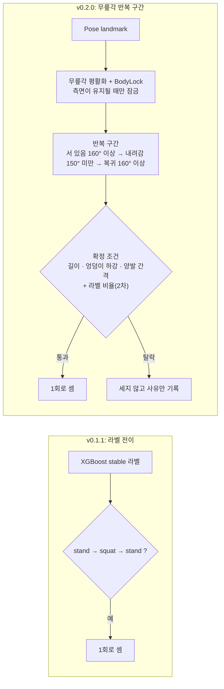

# FitRoute AI Client v0.2.0

> 작성 중 (골격). 각 Phase 완료 시 검증된 내용만 채운다.

## 1. 한 줄 요약

_(Phase 5에서 작성)_

## 2. 무엇이 바뀌었나 (v0.1.1 대비)

- 반복을 **라벨이 아니라 무릎각 시계열**로 나눕니다. 라벨(`walk`, `run`, `lying`)은 반복 구간에 다른 운동이 많이 섞였는지 확인하는 2차 조건으로만 씁니다.
- 걷기처럼 짧은 굴곡, 런지처럼 양발이 앞뒤로 벌어진 동작은 세지 않습니다.
- **측면에서 서 있을 때만** 반복 추적을 시작합니다(정면·사선에서는 세지 않습니다).
- 설정 `USE_REP_TRACKER`를 False로 하면 v0.1.x 방식(라벨 전이)으로 셉니다.
- **개선 1: 짧은 사람 놓침이 서 있는 상태를 지우지 않습니다.** 서 있는 중 사람이나 자세를 1.5초 이하로 놓쳐도(잠금이 유지되는 동안) 서 있던 상태와 기준값을 그대로 두므로, 다시 보인 첫 프레임이 이미 내려가는 중이어도 그 반복을 셉니다. 로그 재생으로 확인한 것: 내려가기 직전에 놓침이 있어 5 FPS로 솎아낸 재생에서 빠지던 반복 3건이 모두 세어지고(수정 전 누락 3건 → 0건), 내려가기 직전에 사람 없음 0.12~0.6초를 끼워 넣은 재생에서 연속 세트 2개와 1차 세션 1~5의 반복이 모두 세어집니다(수정 전에는 0.12초만 덮어도 그 반복을 놓쳤습니다).
- **개선 2: 잠근 다리가 가려져도 반대 다리로 이어받습니다.** 서 있을 때 두 다리가 겹쳐 잠근 다리가 가려지면 반복 추적이 시작되지 않고 멈춰 있던 문제를 고쳤고, 다리 선택에 히스테리시스를 넣었습니다. 로그를 처음부터 다시 계산한 재생에서, 서 있는데 반복 추적이 시작되지 않던 시간이 2026-10-19 빠른 연속 세트 로그에서 5.0초 → 0초, 보통 속도 로그에서 1.1초 → 0초가 되었고 잠금 다리가 바뀐 횟수는 늘지 않았습니다. 두 개선 모두 기존 로그 15개의 센 횟수를 바꾸지 않았습니다.

## 3. 왜 바꿨나

v0.1.1은 XGBoost가 분류한 `stand`/`squat` 라벨이 `stand → squat → stand`로 바뀌면 반복 1회로 셉니다. 이 방식에는 두 가지 한계가 있습니다.

**1. 중간에 다른 동작이 끼어도 1회로 셉니다.**
카운터는 `stand`와 `squat`이 아닌 라벨을 무시하기만 하고 반복을 무효로 하지 않습니다. 그래서 `stand → squat → (걷기·뛰기·눕기 등) → stand`도 1회로 기록됩니다. 반복 도중 자리를 떠났다가 돌아와도 같은 방식으로 이어집니다. 코드를 읽어 확인한 구조이며, 실제 사용 중 얼마나 발생하는지는 측정하지 않았습니다.

**2. 하프 스쿼트는 `squat` 라벨에 기대기 어렵습니다.**
라벨 분류기는 POLAR 정지 이미지 데이터(33,994장)로 학습되었습니다. 이 데이터를 분석한 결과는 다음과 같습니다.

- 측면에서 촬영된 `squat` 샘플의 81.8%(956장 중)가 무릎각 90° 미만입니다. 쪼그려 앉는 깊은 자세가 대부분이고, 얕은 자세는 거의 없습니다.
- 무릎각이 90~150°인 측면 샘플(test 483장)에서 모델이 `squat`이라고 답한 비율은 2.1%입니다. 정답이 `squat`인 샘플만 보면(23장, 표본이 적습니다) 17.4%만 `squat`으로 분류되고 나머지는 주로 `bendover`(47.8%)와 `sit`(17.4%)로 분류됩니다.
- 데이터가 정지 이미지라 시간 순서 정보가 없어, 반복 동작 단위로는 검증할 수 없습니다.

그래서 v0.2.0은 반복 구간을 라벨이 아니라 **무릎각 시계열**로 나눕니다. 라벨은 반복 구간 안에 다른 운동(걷기·달리기·눕기)이 많이 섞였는지를 확인하는 2차 조건으로만 사용합니다. 점프 라벨은 정상 스쿼트의 하강 구간 17%, 상승 구간 22%에서도 나오므로 제외했습니다. (분석 수치의 출처는 DEVLOG의 Phase 0, Phase 0.5 항목)

### v0.1.x 기준선 실측 (2026-10-18, 한 사람, 웹캠 한 대)

실제로 스쿼트를 하며 로그를 남긴 뒤, 로그의 stable 라벨을 기존 카운터에 그대로 넣어 v0.1.x가 몇 회로 셌을지 다시 계산했습니다. **화면에 표시된 카운트를 기록해 둔 7개 세션은 재계산 값과 7/7 일치**했으므로, 아래 재계산 값은 v0.1.x의 실제 동작을 재현한 것입니다(화면 기록이 없는 세션의 값은 재계산이 유일한 근거입니다).

| 세션 | 실제 횟수 | v0.1.x 카운트 | 비고 |
|---|---|---|---|
| 측면, 평행 | 10 | 6 | |
| 측면, 깊게 | 8 | 7 | 화면 기록과 일치 |
| 측면, 얕음(하프) | 8 | **5** | 화면 기록과 일치 |
| 측면, 상체 숙임 | 8 | 7 | 화면 기록과 일치 |
| 측면, 뒤꿈치 들림 | 8 | 5 | |
| 사선 | 5 | 5 | 첫 반복이 늦게 세어졌고 우연히 같음 |
| 정면 | 5 | **2** | 화면 기록과 일치 |
| 측면, 반대 방향 | 5~6 (사용자 기억이 불확실) | **0** | 서 있는 구간이 `run`으로 분류되어 `stand`가 한 번도 안 나옴 |
| 제자리 걷기(스쿼트 아님) | 0 | 0 | 화면 기록과 일치 |
| 의자 앉았다 일어나기 3번(스쿼트 아님) | 0 | **2** | 오카운트, 화면 기록과 일치 |
| 런지 스트레칭 3번(스쿼트 아님) | 0 | **1** | 오카운트, 화면 기록과 일치 |

- 정상 스쿼트를 놓치는 주된 이유는 **올라온 뒤 `stand` 라벨이 나오지 않는 것**입니다(`bendover` 또는 `run`으로 분류). `squat` 라벨 자체는 측면 세션의 반복 48회 모두에 나왔습니다.
- 한 사람, 하루, 세션당 5~10회라 각 비율은 이 환경에서의 관찰이며 일반적인 정확도를 뜻하지 않습니다.

## 4. 판정 항목과 기준

_(Phase 3 완료 후 작성: 깊이, 상체-정강이 각도 차이. 뒤꿈치 들림은 판정하지 않음. 임계값은 확정 전까지 "초기값"으로 표기)_

## 5. 사용 조건과 한계

Phase 2(반복 구간) 기준으로 확인된 것만 적었습니다. 자세 판정(Phase 3)의 한계는 그 단계에서 추가합니다.

- **측면 전용**입니다. 카메라가 사용자의 옆을 볼 때 서 있는 상태에서만 반복 추적이 시작되고, 정면·사선에서는 세지 않습니다. (v0.1.x는 정면에서도 일부 셌습니다: 5회 중 2회.) 정면·사선이거나 발끝이 화면에 다 들어오지 않아 반복 추적이 2초 넘게 시작되지 않으면 화면에 한 줄 안내("카메라 쪽으로 옆모습이 보이게 서주세요" / "발끝까지 화면에 들어오게 서주세요")를 보이고, 추적이 시작되면 지웁니다.
- **의자·박스를 이용한 앉았다 일어나기도 스쿼트로 셀 수 있습니다.** 박스 스쿼트와 동작이 같아 걸러내지 않기로 했습니다. 실측에서 의자 동작 3번이 3회로 세어졌습니다.
- **뒤꿈치 들림은 판정하지 않습니다.** 뒤꿈치를 든 세션과 정상 세션이 landmark 값으로 구분되지 않았고, 촬영 방향에 따라 값이 약 10px 치우쳤습니다.
- **임계값은 한 사람의 하루 데이터로 정한 초기값**입니다(반복 길이 1.0초, 엉덩이 하강량 0.20, 양발 간격 0.25, 라벨 비율 0.40, BodyLock 0.5초/0.4초 등). 다른 사람·다른 날·다른 카메라 배치로 검증하기 전까지 확정이 아닙니다.
- 양발 간격 조건은 측면에서만 쓸 수 있고, 런지를 막는 유일한 기하 조건입니다. 걷기·의자·런지는 각각 3회 안팎으로만 확인했습니다.
- 정면에서의 무릎 안쪽 쏠림(valgus)은 지원하지 않습니다.
- **자세 점수는 깊이와 상체 정렬만 평가합니다.** 깊이는 최저점의 무릎 각도, 상체 정렬은 최저점에서 몸통과 정강이의 각도 차이입니다. 뒤꿈치 들림, 동작 속도(템포), 무릎이 발끝을 넘는 정도, 허리 굽음, 무릎 안쪽 쏠림은 평가하지 않으므로 점수가 높아도 이들이 올바르다는 뜻이 아닙니다. 점수 기준은 한 사람의 하루 데이터로 정한 초기값입니다.
- **자세 점수는 서버에 저장되지 않습니다.** 0.2.0은 클라이언트만 바뀌며, 자세 점수는 화면과 로컬 기록에만 둡니다. Supabase 스키마, 백엔드 API, 대시보드 표시는 0.3.0 후보입니다.

## 6. 검증 방법

_(합성 시퀀스 테스트, 실제 로깅 데이터 수. 측정한 값만 기재)_
