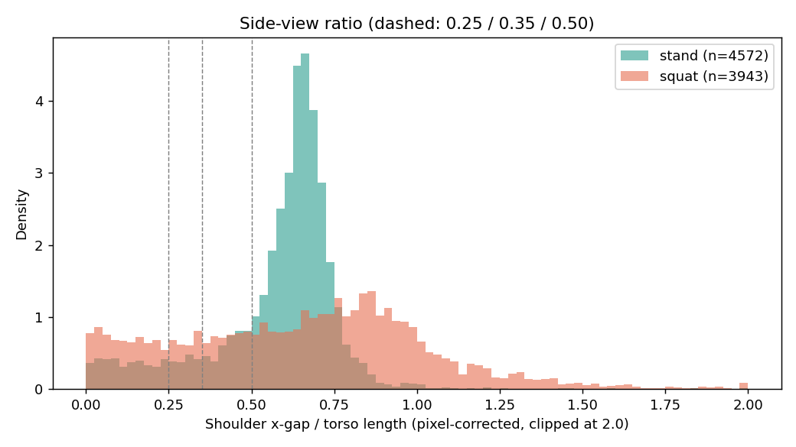
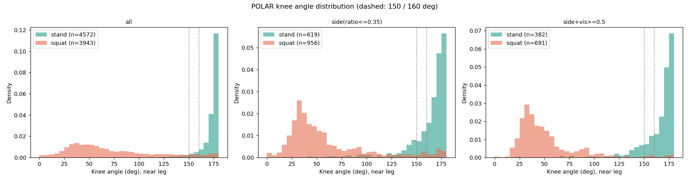

# Phase 0 분석 결과

- 생성 시각: 2026-10-12 15:16:16
- 데이터 경로(이 PC 기준): `D:\LDH_PRG_CV\2_vision_ai\Pose_actionrecognition\data`

## 데이터 출처

| path | rows | size_bytes | modified |
| --- | --- | --- | --- |
| D:\LDH_PRG_CV\2_vision_ai\Pose_actionrecognition\data\processed\polar_mediapipe\dataset.csv | 33994 | 88744868 | 2026-09-11 14:09:57 |
| D:\LDH_PRG_CV\2_vision_ai\Pose_actionrecognition\data\processed\polar_mediapipe\failed_samples.csv | 1330 | 97601 | 2026-09-11 14:09:57 |
| D:\LDH_PRG_CV\2_vision_ai\Pose_actionrecognition\data\processed\polar_mediapipe\classes.json | 9 | 110 | 2026-09-11 13:41:24 |

## 1. 메타데이터 컬럼

| column | dtype | example |
| --- | --- | --- |
| sample_id | object | train__p1_00001__person_0 |
| image_name | object | p1_00001.jpg |
| person_index | int64 | 0 |
| split | object | train |
| class_id | int64 | 7 |
| label | object | stand |

- 전체 컬럼 138개 = 메타 6 + feature 132
- sample_id 중복 없음: True
- image_name 고유 수: 33994 / 행 33994
- person_index 분포: {0: 33994}
- split 분포: {'train': 20397, 'val': 6808, 'test': 6789}
- class 분포: {'sit': 4996, 'stand': 4572, 'squat': 3943, 'run': 3620, 'bendover': 3514, 'jump': 3498, 'lying': 3390, 'stretch': 3255, 'walk': 3206}

### crop 픽셀 w, h 복원 검증

복원식: `labels/*.txt`(YOLO bbox) + `Annotations/*.json`(원본 width/height) → 학습 저장소와 동일한 padding 0.3. 검증: `extraction_summary.json`의 crop_statistics와 대조.

- 대조 대상: dataset.csv + failed_samples.csv = 35324행
- width_min: restored=21.000000 summary=21.000000 MATCH
- width_mean: restored=291.561148 summary=291.561148 MATCH
- width_max: restored=596.000000 summary=596.000000 MATCH
- height_min: restored=27.000000 summary=27.000000 MATCH
- height_mean: restored=377.128921 summary=377.128921 MATCH
- height_max: restored=767.000000 summary=767.000000 MATCH
- restored rows: 35324 / 35324

## 2. 측면 샘플 필터

- 비율 = |왼쪽 어깨 x − 오른쪽 어깨 x| ÷ (어깨 중점 ~ 엉덩이 중점 거리), 모두 crop 픽셀 좌표로 보정 후 계산
- 주 임계값 0.35 (**임시 초기값**). 아래 표로 민감도를 함께 확인

| class | total | ratio_nan | ratio<=0.25 | ratio<=0.35 | ratio<=0.5 |
| --- | --- | --- | --- | --- | --- |
| stand | 4572 | 0 | 430 | 619 | 1056 |
| squat | 3943 | 0 | 688 | 956 | 1391 |

## 3. stand / squat 무릎각 분포 (가까운 쪽 다리)

- 가까운 쪽 다리: hip, knee, ankle visibility 합이 큰 쪽
- `side+vis`: 측면 필터 + 다리/몸통 관절 visibility ≥ 0.5

| class | subset | n | p5 | p25 | p50 | p75 | p95 |
| --- | --- | --- | --- | --- | --- | --- | --- |
| stand | all | 4572 | 146.2 | 171.6 | 176.1 | 178.3 | 179.7 |
| stand | side(ratio<=0.35) | 619 | 114.0 | 158.2 | 170.5 | 175.9 | 179.2 |
| stand | side+vis>=0.5 | 382 | 135.1 | 161.9 | 172.3 | 176.7 | 179.4 |
| squat | all | 3943 | 18.0 | 38.5 | 59.5 | 98.9 | 165.4 |
| squat | side(ratio<=0.35) | 956 | 19.1 | 32.3 | 45.2 | 70.9 | 159.8 |
| squat | side+vis>=0.5 | 691 | 21.8 | 31.7 | 42.1 | 58.3 | 110.1 |

### landmark가 crop(0~1) 밖에 있는 비율

| class | n | left_hip | left_knee | left_ankle | right_hip | right_knee | right_ankle |
| --- | --- | --- | --- | --- | --- | --- | --- |
| stand | 4572 | 6.0% | 24.1% | 34.1% | 6.1% | 24.6% | 34.2% |
| squat | 3943 | 2.7% | 2.8% | 7.0% | 2.7% | 3.0% | 7.3% |

## 4. failed_samples.csv 클래스 분포

- 실패 사유: {'pose_not_detected': 1330}

| class | success | failed | total | fail_rate_% | share_of_failures_% | share_of_all_samples_% |
| --- | --- | --- | --- | --- | --- | --- |
| bendover | 3514 | 353 | 3867 | 9.13 | 26.54 | 10.95 |
| squat | 3943 | 310 | 4253 | 7.29 | 23.31 | 12.04 |
| lying | 3390 | 191 | 3581 | 5.33 | 14.36 | 10.14 |
| walk | 3206 | 91 | 3297 | 2.76 | 6.84 | 9.33 |
| sit | 4996 | 105 | 5101 | 2.06 | 7.89 | 14.44 |
| stretch | 3255 | 67 | 3322 | 2.02 | 5.04 | 9.40 |
| jump | 3498 | 64 | 3562 | 1.80 | 4.81 | 10.08 |
| stand | 4572 | 84 | 4656 | 1.80 | 6.32 | 13.18 |
| run | 3620 | 65 | 3685 | 1.76 | 4.89 | 10.43 |

### class × split

| label | test | train | val |
| --- | --- | --- | --- |
| bendover | 73 | 207 | 73 |
| jump | 13 | 36 | 15 |
| lying | 40 | 112 | 39 |
| run | 18 | 34 | 13 |
| sit | 27 | 63 | 15 |
| squat | 56 | 203 | 51 |
| stand | 16 | 51 | 17 |
| stretch | 9 | 45 | 13 |
| walk | 24 | 46 | 21 |

### 성공/실패 crop 크기 비교 (픽셀)

| class | group | n | crop_w_median | crop_h_median | crop_h_p10 | aspect_h/w_median |
| --- | --- | --- | --- | --- | --- | --- |
| squat | success | 3943 | 295.0 | 339.0 | 203.0 | 1.3 |
| squat | failed | 310 | 264.0 | 311.5 | 116.0 | 1.2 |
| stand | success | 4572 | 239.0 | 457.0 | 284.0 | 2.0 |
| stand | failed | 84 | 258.0 | 396.5 | 170.2 | 1.6 |
| bendover | success | 3514 | 320.0 | 352.0 | 231.6 | 1.3 |
| bendover | failed | 353 | 314.0 | 339.0 | 176.0 | 1.3 |
| lying | success | 3390 | 444.0 | 338.0 | 212.0 | 0.7 |
| lying | failed | 191 | 444.0 | 338.0 | 201.0 | 0.8 |
